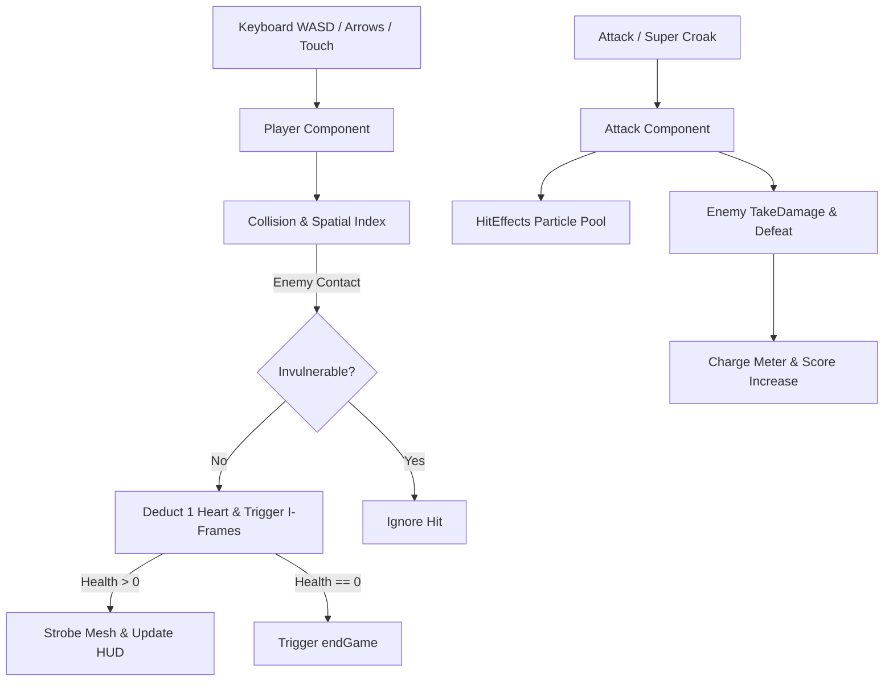

# Requirements

### Overview & Goals
The objective of this enhancement plan is to maximize overall player enjoyment, accessibility, and technical stability while minimizing frustration, micro-stutters, and motor friction. By transitioning from instant-death mechanics to a forgiving health system with invulnerability frames, expanding control options to universal standards, and optimizing memory allocation through particle pooling, the game delivers the highest possible net benefit to both casual players and learners studying the codebase.

### Scope
- **In Scope:**
  - Player health system with 3 hearts, hit recovery, visual damage flashing, and invulnerability frames (i-frames).
  - Flexible movement controls adding full `WASD` support alongside existing arrow keys and touch controls.
  - "Super Croak" secondary charge ability building up from enemy defeats and tea brewing.
  - Object pooling for combat hit effects and particles to eliminate garbage collection spikes.
  - Centralized game tuning configuration and developer debug overlay for inspecting real-time metrics and spatial boundaries.
- **Out of Scope:**
  - Replacing existing 3D models or adding heavy external asset files.
  - Modifying files outside the `game/` directory.
  - Altering core grid navigation geometry or house obstacle generation logic.

### User Stories
- **As a player**, I want my character to withstand occasional enemy contacts and have a brief grace period so that a single mistake does not immediately end a long, rewarding run.
- **As a keyboard user**, I want to navigate using standard `WASD` keys so that I can play comfortably using my preferred hand posture.
- **As a tactical player**, I want to build up a secondary charge ability through skilled play so that I can escape overwhelming enemy swarms.
- **As a learner/developer**, I want a live debug overlay and centralized balance configuration so that I can understand spatial mechanics and tune gameplay parameters efficiently.

### Functional Requirements
- **Health & Invulnerability:**
  - Player starts with 3 maximum health points represented by heart icons in the top HUD.
  - Enemy contact deducts 1 health point and triggers 1.5 seconds of invulnerability.
  - During invulnerability, Tode's model flashes with altered opacity, and incoming enemy contacts do not deduct health.
  - Health depletion (0 hearts) triggers standard game over sequence.
  - Restarting the game restores health to maximum.
- **Control Schemes:**
  - Keys `KeyW` / `w`, `KeyA` / `a`, `KeyS` / `s`, `KeyD` / `d` map seamlessly to Up, Left, Down, and Right movement vectors.
  - Controls HUD legend reflects both Arrow Keys and WASD options.
- **Super Croak Secondary Ability:**
  - Defeating enemies grants +10% charge; brewing tea grants +50% charge.
  - At 100% charge, triggering the ability creates an expanding radial shockwave (1.8x standard attack radius) that deals damage and knocks enemies back 40 units.
- **Resource Optimization & Debugging:**
  - Particle bursts recycle active `THREE.Mesh` instances from a pre-allocated pool of 30 particles.
  - Pressing the backtick key (`` ` ``) toggles an unobtrusive developer HUD showing current FPS, active enemy count, spatial index cell count, and player health/position.

### Non-Functional Requirements
- **Performance:** Maintain a consistent 60 FPS on standard desktop and mobile hardware without memory leaks or garbage collection hitches.
- **Accessibility:** Ensure high-contrast visual cues for damage states and full keyboard navigation independence.
- **Code Standards:** Adhere strictly to the project's modular Three.js architecture and encapsulate changes inside the `game/` directory.

# Technical Design

### Current Implementation
- **Player & Collision:** In `game/src/components/Player.js` and `game/src/main.js`, any overlapping collision detected via `isMoveClear` or `player.update()` immediately executes `endGame()`.
- **Input Handling:** Movement is bound exclusively to `ArrowUp`, `ArrowDown`, `ArrowLeft`, and `ArrowRight` in `Player.js`.
- **Combat Effects:** `HitEffects.js` instantiates and disposes Three.js meshes dynamically upon every hit.
- **Configuration:** Tuning parameters (speeds, multipliers, radii) are dispersed across `Difficulty.js`, `Attack.js`, `Player.js`, and `EnemyTypes.js`.

### Key Decisions
- **Decision: 3-Heart Health with Invulnerability Period**
  - *Rationale:* Maximizes player retention and fairness by replacing unforgiving instant-death with a recovery window that encourages calculated risk-taking.
- **Decision: Dual-Key Movement Mapping (Arrow Keys + WASD)**
  - *Rationale:* Accommodates ergonomic diversity without breaking existing muscle memory or mobile touch control integration.
- **Decision: Lightweight In-Memory Particle Object Pool**
  - *Rationale:* Reusing particle meshes prevents transient allocations during chaotic multi-enemy combat bursts, ensuring smooth frame delivery.
- **Decision: Modular Debug Overlay**
  - *Rationale:* Provides immediate visibility into internal game states for rapid tuning and educational inspection without polluting production UI.

### Proposed Changes
- **`game/src/components/Player.js`:**
  - Add `health`, `maxHealth`, and `invulnerabilityTimer` fields.
  - Add `takeDamage(amount)` method that triggers temporary i-frames.
  - Extend `DIRECTIONS` map to support `KeyW`, `KeyA`, `KeyS`, `KeyD`, `w`, `a`, `s`, `d`.
  - Update `update(delta)` to decrement `invulnerabilityTimer` and apply mesh opacity strobe effects while invincible.
- **`game/src/components/Attack.js` & `game/src/components/HitEffects.js`:**
  - Add `charge` meter management (0 to 100) to `Attack.js`.
  - Implement `triggerSuperCroak()` method dealing high radial damage and knockback.
  - Refactor `HitEffects.js` to maintain an internal pool array of `THREE.Mesh` instances, recycling detached particles.
- **`game/src/components/Difficulty.js`:**
  - Consolidate game balance constants (`PLAYER_MAX_HEALTH`, `INVULNERABILITY_DURATION`, `SUPER_CROAK_RADIUS`, `SUPER_CROAK_CHARGE_PER_KILL`) into a centralized config object.
- **`game/src/components/Sound.js`:**
  - Add synthesized frequency sweeps for damage received and low-health pulsation.
- **`game/src/main.js` & `game/src/style.css`:**
  - Create heart container elements in the DOM HUD (`<div class="player-hearts">`).
  - Update collision handling loop to call `player.takeDamage(1)` instead of direct `endGame()` if not invincible.
  - Add debug toggle listener (`` ` `` key) displaying FPS counter and entity statistics.

### Components & File Structure
```
game/src/
├── components/
│   ├── Attack.js          # Extended with charge meter and Super Croak shockwave
│   ├── Difficulty.js      # Centralized balance configuration and scaling logic
│   ├── HitEffects.js      # Refactored with particle object pooling
│   ├── Player.js          # Enhanced with health, i-frames, and WASD input mappings
│   ├── Sound.js           # New audio cues for damage and charge status
│   └── ... (existing components preserved)
├── main.js                # HUD heart indicators, damage routing, debug overlay
└── style.css              # Heart UI, charge bar styling, debug HUD layout
```

### Architecture Diagram


### Risks & Mitigations
- **Risk:** Rapid consecutive collision updates might drain all hearts in a single frame.
  - *Mitigation:* Ensure `invulnerabilityTimer` is set immediately upon first contact and strictly checked before any health deduction.
- **Risk:** Object pool running out of available meshes during massive wave attacks.
  - *Mitigation:* Implement dynamic pool growth with soft limits so particle bursts gracefully fallback without crashing or freezing.

# Testing

### Validation Approach
Verification will be performed directly within the game runtime, validating that mechanics enhance player agency, maintain robust error margins, and run without performance degradation.

### Key Scenarios
- **Scenario 1: Player Damage & Invulnerability**
  - Walk into an active enemy. Verify that exactly 1 heart is deducted, the HUD updates from 3 to 2 hearts, the player mesh strobes, and audio feedback plays.
  - Remain touching the enemy during the 1.5-second i-frame window. Verify that no additional damage is taken until the i-frames expire.
  - Take repeated hits until health reaches 0. Verify that `endGame()` is called and the Game Over screen displays properly.
- **Scenario 2: WASD Navigation**
  - Press `W`, `A`, `S`, `D` individually. Verify that Tode hops in Up, Left, Down, and Right directions with identical precision and speed to the Arrow keys.
- **Scenario 3: Super Croak Charge & Discharge**
  - Defeat enemies and brew tea. Verify that the HUD charge meter advances from 0% to 100%.
  - Trigger Super Croak at full charge. Verify that a wide shockwave visual appears, surrounding enemies take damage/knockback, and the charge meter resets to 0.
- **Scenario 4: Particle Pool Recycling**
  - Trigger repeated attacks against enemy swarms. Verify in developer tools that memory footprint remains stable without unbounded mesh allocation.
- **Scenario 5: Restart & State Reset**
  - Restart after game over. Verify that hearts reset to 3, charge meter resets to 0, and input queues are cleared.

### Edge Cases
- **Simultaneous Enemy Hits:** Ensure multiple enemies colliding in the exact same frame only deduct 1 heart due to immediate i-frame activation.
- **Boss Charge Impact:** Verify boss charges during i-frames do not instantly kill the player but correctly register hit feedback.
- **Settings & Pause Transitions:** Pausing while invincible must freeze the `invulnerabilityTimer` so no grace time is lost while in menu dialogs.

# Delivery Steps

### ✓ Step 1: Implement Player Health, Invulnerability Frames, and Heart HUD
The player survives initial enemy contacts with a multi-hit health pool and visual invulnerability frames.

- Update `game/src/components/Player.js` to manage player hit points (3 maximum hearts), invulnerability timer (1.5s duration with visual mesh opacity flashing), and damage receipt logic.
- Modify `game/src/main.js` collision checks to deduct health and activate i-frames upon enemy contact rather than immediately triggering `endGame()`.
- Add a responsive heart-based health bar to the HUD overlay in `game/src/main.js` and style it in `game/src/style.css`.
- Ensure game over triggers only when player health reaches zero, and reset health to full upon restarting.

### ✓ Step 2: Expand Movement Controls (WASD) and Audio Accessibility
Players can move using standard WASD keys and experience synthesized low-health warning cues.

- Update `game/src/components/Player.js` input mapping table to bind `KeyW`, `KeyA`, `KeyS`, `KeyD`, and lowercase `w`, `a`, `s`, `d` alongside existing arrow keys.
- Update on-screen control guides in `game/src/main.js` (`controlsGuide`) to reflect WASD and Arrow key support.
- Extend `game/src/components/Sound.js` with audio feedback for player damage receipt and low-health heartbeats.
- Update `game/src/components/Settings.js` to ensure sound volume scaling affects newly added audio cues.

### ✓ Step 3: Implement Super Croak Charge Ability and Particle Pooling
Players can charge and unleash a powerful area knockback shockwave, while particle allocations are recycled to maintain steady framerates.

- Implement charge accumulation in `game/src/components/Attack.js` that fills from regular enemy defeats and tea brewing.
- Add secondary ability trigger logic (Double-tap Space or secondary action) that releases a wide-area "Super Croak" shockwave knocking enemies back.
- Create a lightweight object pool in `game/src/components/HitEffects.js` to recycle particle geometries and mesh instances instead of allocating new objects during heavy combat waves.
- Connect charge bar HUD indicators in `game/src/main.js` and `game/src/style.css`.

### ✓ Step 4: Centralize Game Configuration and Integrate Debug Inspector
Game balance constants are cleanly decoupled, and developers can inspect collision boundaries and live metrics on demand.

- Create a unified configuration module in `game/src/components/Difficulty.js` centralizing movement speeds, health parameters, drop rates, and wave scaling coefficients.
- Build a lightweight runtime debug inspector overlay toggled via the backtick key (`\``) or settings toggle to display real-time FPS, active entity counts, spatial grid occupancy, and collision bounds.
- Connect debug inspector hooks into `game/src/main.js` and `game/src/components/SpatialIndex.js` without impacting release performance.